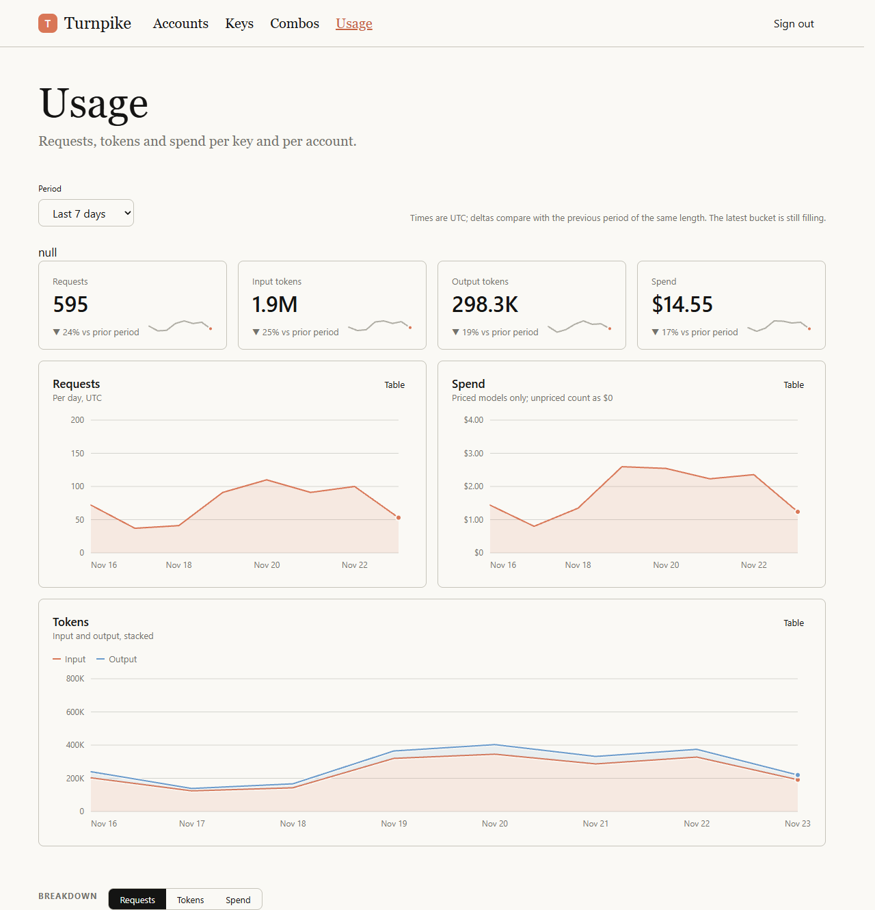

# Turnpike

A self-hosted LLM router for Cloudflare Workers. Add upstream provider accounts, group models into ordered fallback lists (**combos**), and hand out **router keys** with spend caps. Clients talk to one URL in either the OpenAI or the Anthropic format; Turnpike translates between the two when the upstream speaks the other one.

State lives in one SQLite-backed Durable Object. There is no database to run, no build step for the dashboard, and one runtime dependency (`hono`).



## Features

- **Two APIs, any upstream.** `POST /v1/chat/completions` and `POST /v1/messages`, streaming and non-streaming, translated both ways.
- **Combos.** An ordered list of `{account, model}` targets. A request tries them in order and falls through on a 408, 429 or 5xx (or a network error).
- **Model discovery.** Each account's `/models` list is fetched when you add it, once a day, and on demand. `GET /v1/models` returns your combos plus every provider model as `<account>/<model>`.
- **Router keys with limits.** Daily and monthly USD caps, requests per minute, in-flight requests, and a per-key account allow-list. Secrets are shown once and stored only as SHA-256 hashes.
- **Account limits.** RPM, TPM and monthly USD per account, plus automatic cooldown on upstream 429s.
- **Usage dashboard.** KPI tiles with period-over-period change, requests/tokens/spend over time, and ranked breakdowns by model, key and account. Every chart has a table view.
- **Providers.** OpenRouter, OpenCode Zen, OpenCode Go, GitHub Copilot (device-flow OAuth), and any OpenAI- or Anthropic-compatible endpoint.

| Route | Purpose | Auth |
|---|---|---|
| `POST /v1/chat/completions` | OpenAI-compatible chat | router key |
| `POST /v1/messages` | Anthropic-compatible messages | router key |
| `GET /v1/models` | Combos and `<account>/<model>` entries the key may use | router key |
| `/` | Dashboard (static files in `public/`) | admin token, entered in the page |
| `/admin/*` | Admin API used by the dashboard | `Authorization: Bearer <ADMIN_TOKEN>` |
| `GET /health` | `{"ok":true}` | none |

Router keys are sent as `Authorization: Bearer <key>` or `x-api-key: <key>`.

## Quick start

```sh
npm install
cp .dev.vars.example .dev.vars   # then set ADMIN_TOKEN to a long random value
npm run dev
```

Open the URL `wrangler dev` prints (normally http://localhost:8787) and sign in with the admin token. `.dev.vars.example` ships `ADMIN_TOKEN=change-me`: change it, because a left-in example value is the real admin token locally.

## Deploy

```sh
npx wrangler login
npm run deploy
openssl rand -hex 32 | npx wrangler secret put ADMIN_TOKEN   # or paste your own value
```

Until `ADMIN_TOKEN` is set, `/admin/*` answers 503. The first deploy prints your URL (`https://turnpike.<subdomain>.workers.dev`). No resource IDs need pasting: `wrangler.jsonc` declares one Durable Object binding (`HUB`, class `Hub`) and the static assets directory.

To rotate the admin token, run `wrangler secret put ADMIN_TOKEN` again and sign in with the new value. Redeploying never touches stored data: accounts, keys, combos and usage live in the Durable Object, and the token is a Worker secret.

## First use

1. **Accounts → add an account.** Pick a kind, give it a name and API key. Custom kinds also need a base URL (https, or http for localhost). The model list appears within seconds; press **Refresh** to re-fetch.
2. **Combos → create a combo.** Add targets and pick models from the account's list (or type one).
3. **Keys → create a router key.** Set caps and tick the accounts it may use. Copy the secret then; it is not shown again.
4. **Usage.** Watch requests, tokens and spend. If a model has no price, a notice offers a one-click price override.

A friend uses the key like this:

```sh
# OpenAI SDKs and tools
export OPENAI_BASE_URL=https://<worker>/v1
export OPENAI_API_KEY=<router key>

# Anthropic SDKs and tools (no /v1: the SDK appends /v1/messages itself)
export ANTHROPIC_BASE_URL=https://<worker>
export ANTHROPIC_API_KEY=<router key>
```

The `model` is a combo name or `<account name>/<model>` (account matched case-insensitively), for example `openrouter/anthropic/claude-sonnet-4`.

```sh
curl https://<worker>/v1/chat/completions -H "Authorization: Bearer <key>" -H "content-type: application/json" \
  -d '{"model":"my-combo","messages":[{"role":"user","content":"hi"}]}'
```

Errors: 401 bad key, 404 unknown model (or one the key may not use), 429 `limit: <reason>` when every target is blocked (`key_daily`, `key_monthly`, `account_monthly`, `rpm`, `tpm`, `cooldown`), 400 `limit: unpriced` when a capped key asks for a model with no known price, 502 for upstream account errors.

## Limits and pricing

| Limit | Scope | Behavior |
|---|---|---|
| Daily / monthly USD | per router key | Checked before each request against recorded spend, in-flight reservations and the estimated cost of this request. UTC day and month. |
| RPM / in-flight | per router key | Defaults of 30 and 4 for keys made in the dashboard; clear a field for none. |
| RPM / TPM / monthly USD | per account | Rolling 60 seconds for RPM and TPM; TPM counts the estimated input tokens (about 4 characters per token). |
| Upstream 429 | per account | Cooldown for the upstream `Retry-After` (default 30 s, capped at 15 min); the request falls through to the next target. |

Expected output cost is estimated from `max_tokens` (default 4096, capped at 32,000), then replaced by real usage when the response completes.

Prices come from OpenRouter's public model list, refreshed daily, plus manual overrides (Usage tab or `PUT /admin/prices`). An override matches the exact model string sent upstream (the part after `<account>/`, or the combo target's `model`). A model with no price counts as $0 and is **refused for keys that have a USD cap**; keys without a cap can use it, so price the models you use.

## Backup and retention

**Accounts → Download backup** (or `GET /admin/export`, add `?ledger=0` to skip usage) returns accounts, keys, combos, price overrides and the usage ledger as JSON. Provider secrets are redacted, so re-enter them after a restore; key hashes are included so existing router keys keep working. The usage ledger keeps 400 days and is pruned daily.

Cloudflare also keeps 30 days of point-in-time history for SQLite-backed Durable Objects. Turnpike does not expose a restore route; use Cloudflare's tooling if you need one.

## Security

- **Admin token** controls everything. Use a long random value. After 10 failed attempts an IP is locked out of `/admin` for a minute (it keys on the `cf-connecting-ip` header Cloudflare sets, so it is off in local dev).
- **Router keys** are stored only as SHA-256 hashes; the secret is shown once. Revoke from the Keys tab (`DELETE /admin/keys/:id`): a revoked key gets 401.
- **Provider secrets** (API keys, OAuth tokens) sit in plain form in the Durable Object's SQLite storage. They are redacted in admin responses and exports and never sent to the dashboard, but anyone who can deploy code to your Cloudflare account can read them. Encrypting them with a Worker secret would not change that, so Turnpike does not.
- **Upstream hygiene.** Only an allow-list of request fields is forwarded; only a few response headers are returned; upstream error bodies are replaced with generic messages; redirects are not followed; server-side tools that bill separately are refused.
- **Exposure.** The Worker URL is public and the dashboard HTML needs no auth (the API behind it does). Consider [Cloudflare Access](https://developers.cloudflare.com/cloudflare-one/policies/access/) in front of `/` and `/admin/*`.

## Terms of service

Sharing a subscription login (GitHub Copilot) through router keys may violate the provider's terms and put the account at risk. Key allow-lists exist so a friend's key can be limited to API-key accounts. Claude and ChatGPT subscription logins are intentionally not supported: Anthropic's docs forbid routing requests through Free, Pro or Max logins, and OpenAI offers third parties no client registration for Codex-style login that works from a hosted app. A `codex-oauth` kind exists in the code as an unimplemented placeholder and is not offered in the dashboard.

## Known limitations

- The Copilot client ID, token exchange and editor headers are undocumented and were taken from open-source clients (see `src/oauth/copilot.ts`). The device flow has not been run against GitHub from a deployed Worker; try it once by hand.
- OpenCode Zen and Go default base URLs follow the provider docs as of 2026-11-23. `opencode-go` sends the account id as the required `x-opencode-session` header. Set a base URL on the account if a default is wrong.
- A provider whose `/models` needs different auth or does not exist shows 0 models; combos still work with a typed model.
- One Durable Object serves all traffic, which is plenty for personal and small-team use but is a throughput ceiling.
- Token estimates ignore tool definitions, and 1-hour Anthropic cache writes are billed at the 5-minute rate in Turnpike's accounting.
- Usage times and caps are UTC.
- Some tests reach `reserve` and can trigger a real price-refresh request to openrouter.ai; some print "token refresh failed" lines from deliberately failing refreshes. The run still passes.

## Development

```sh
npm test            # vitest on the Workers pool
npm run typecheck   # tsc --noEmit
npm run e2e:stub    # stub upstream on :9101
npm run e2e         # end-to-end smoke against `wrangler dev` (ADMIN_TOKEN=e2e-admin-token)
```

CI runs typecheck and tests on every push and pull request.

| Path | Contents |
|---|---|
| `src/index.ts` | Hono app: `/health`, `/admin`, `/v1` |
| `src/auth.ts` | Admin token (with lockout) and router key middleware |
| `src/admin.ts` | Admin API and input validation |
| `src/proxy.ts` | `/v1` handlers, usage recording, 429 cooldown, `/v1/models` |
| `src/router.ts` | Model resolution and fallback loop |
| `src/providers.ts` | Account kinds, default base URLs, upstream calls, model discovery |
| `src/translate/` | OpenAI and Anthropic request, response and SSE translation |
| `src/hub.ts` | Durable Object: keys, accounts, combos, ledger, limits, prices, models, token refresh |
| `src/oauth/` | OAuth providers (Copilot device flow) |
| `src/pricing.ts` | Price lookup and OpenRouter refresh |
| `public/` | Dashboard: static HTML and ES modules, no build step; `charts.js` is a small dependency-free SVG chart kit |
| `test/` | Vitest suites and `dashboard-smoke.md` (manual dashboard checklist) |
| `scripts/` | Stub upstream and end-to-end smoke test |

The dashboard follows the [DesignMD "Anthropic" design system](https://designmd.me/discover/anthropic) (cream and near-black palette, terracotta accent, serif headings), with the document's fallback fonts. The original design and task history is in `docs/superpowers/plans/2026-11-22-turnpike.md`.

## License

[MIT](LICENSE)
